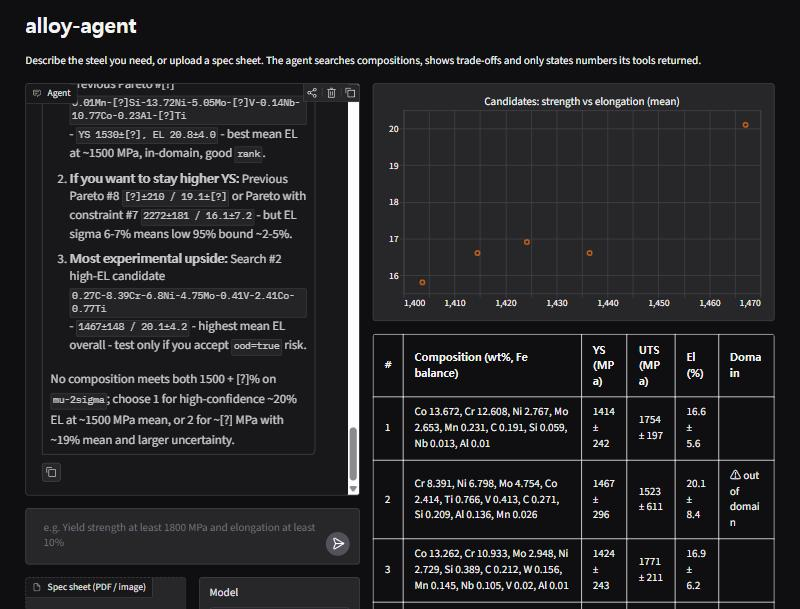
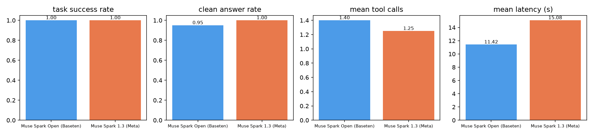

# alloy-agent

Describe the steel you need, in plain language or as a spec-sheet PDF/photo. A Muse Spark agent turns it into
constraints, searches compositions with an uncertainty-aware predictor, explores the strength–ductility
trade-off, and answers with ranked candidates and calibrated ±2σ bands. **Every number in the answer comes
from a tool**: a code verifier checks the prose and strips anything it cannot trace. Out-of-domain candidates
are flagged, never hidden. When a goal is out of reach, the agent says which constraint binds and by how much,
instead of inventing an alloy.

**Demo video (2 min):** https://youtu.be/kuGOBx8772k



## How it works

```
Gradio UI ─ chat + spec upload │ agent trace │ Pareto scatter │ candidate table (μ ± 2σ, OOD ⚠)
   ▼
intake   PDF/image ──► Muse Spark 1.3 (multimodal) ──► constraints JSON
agent    Muse Spark (Open on Baseten, or 1.3 on Meta Model API) ⇄ 3 tools, hard caps:
         ≤6 tool calls, ≤2 refine loops, token budgets per turn and session
tools    predict(composition)                      → μ, σ for YS / UTS / El + out-of-domain flag
         search(constraints, bounds?)              → ranked by conservative margin (μ−2σ ≥ target);
                                                      if none feasible: which constraint binds, short by how much
         pareto(objectives, constraints?)          → non-dominated trade-off front; rank = promise ÷ uncertainty
                                                      ("which alloy to melt next")
verify   numbers in prose ⊆ tool outputs ∪ user's numbers, matched at their written precision (μ±2σ recomputed in code);
         reject → one rewrite → otherwise strip the unsupported numbers. The table is filled by code, not the LLM.
```

The LLM decides what to do. All numbers come from code: predictions, margins, the table, and the check.

**Predictor** (`src/alloy_agent/predictor.py`, trained at start-up in ~20 s)
- **Model:** per target, a 20-model bootstrap ensemble. The regressor (gradient boosting or random forest) is
  picked by 5-fold MAE.
- **Uncertainty:** σ = a + b·σ_ensemble. (a, b) is chosen as the narrowest band that keeps μ ± 2σ covering 95% of
  out-of-fold rows.
- **Domain check:** per-element training ranges plus kNN distance to the training set.

## Results

### Predictor (5-fold out-of-fold, 312 steels; elongation 303)

| Target | MAE | μ ± 2σ coverage | mean ±2σ half-width |
|---|---|---|---|
| Yield strength | 98.8 MPa | 94.9% | ±129 MPa |
| Tensile strength | 97.1 MPa | 94.9% | ±122 MPa |
| Elongation | 2.55 % | 94.7% | ±3.4 % |

Affine calibration gives bands 35–45% narrower than a single scalar multiplier, at the same coverage.

### Agent (20 English queries × 2 backends, `eval/`)

| | Muse Spark Open (Baseten) | Muse Spark 1.3 (Meta Model API) |
|---|---|---|
| Task success | **20 / 20** | **20 / 20** |
| Clean answer (verifier stripped nothing) | 16 / 20 | **20 / 20** |
| Mean tool calls | 1.3 | 1.3 |
| Mean latency | **13.8 s** | 16.4 s |
| Tokens, all 20 queries | 234k | 207k |
| Turns that hit a cap | 0 | 0 |



**What the queries cover**
- 8 feasible, 4 infeasible (one stated in ksi), 4 trade-off, 2 out-of-domain, 2 multi-turn follow-ups.
- The expected outcome of each query was labeled by running the tools directly. So this measures whether the
  agent uses the tools correctly and answers honestly, not whether the alloys exist.

**How we got here.** Each fix below came from reading eval failures, and each has a test:
- **First run:** 13/20 and 15/20 strict. The verifier was too strict on follow-ups and comma lists, and the
  prompt allowed approximations.
- **Code review:** our own 1% tolerance let invented numbers slip through once a 15-candidate front was in
  context. A number now has to match a tool value to the precision it is written with.
- **Third run:** on two queries the Meta model returned an empty final answer. The agent now asks again, and
  if the answer is still empty it falls back to a summary of the tool results.

The open-weight model is faster. It also approximates more often (for example "~2,000 MPa"), so its answer is
"clean" (the verifier stripped nothing) on 16/20 queries. In the other 4, the verifier replaced those numbers
with `[?]` rather than let them through.

**Held-out rediscovery (`eval/rediscovery.py`, no LLM): 0 / 31.** We hid the strongest 10% of steels and
retrained. Every held-out target then lies above the model's training range, and tree ensembles do not
extrapolate. So `search` reports these targets as infeasible, with the binding constraint, rather than proposing
the hidden alloys. This is the honest boundary of a 312-row model.

## Limitations
- **Small, narrow data:** 312 steels, mostly maraging / ultra-high-strength (YS ≈ 1000–2500 MPa). The model does
  not extrapolate beyond that.
- **Conservative screening is strict:** most "high strength and ≥10% elongation" goals are infeasible at μ−2σ.
  The agent says so and offers the trade-off front instead.
- **No experimental validation:** candidates are hypotheses to test, ranked by promise per unit uncertainty.
- **No stress-strain curves:** total elongation alone cannot support a Hollomon fit, so we did not fake one.

## Run it

```bash
python -m venv .venv
.venv/Scripts/pip install -e ".[dev]"     # Windows; .venv/bin/pip elsewhere
cp .env.example .env                       # BASETEN_API_KEY and/or MODEL_API_KEY
python app.py                              # http://127.0.0.1:7860
```

- **Backend:** switch in the UI, or set `LLM_BASE_URL` / `LLM_MODEL`. The default is
  `meta-models/muse-spark-open-1026` on Baseten; the alternative is `muse-spark-1.3` on `https://api.meta.ai/v1`.
- **Spec-sheet intake:** uses the Meta Model API. Try `demo/spec_landing_gear.pdf` or `demo/spec_table.png`.
- **Replay mode:** `REPLAY=runs.jsonl python app.py` re-renders saved turns without calling any LLM.
- **Tests:** `pytest`. 50 offline tests; the LLM is stubbed.
- **Eval:** `python eval/run_eval.py --backend baseten|meta`, then `python eval/run_eval.py --plot`.

## Data
Figshare *Steel Strength Data* (MIT), originally from Citrine Informatics. It is downloaded and checksum-verified on
first use, not committed. Details and citations: [DATA.md](DATA.md).

## Built during the hackathon
Everything here was written from an empty repository during the Meta Global AI Developer Hackathon. The first
commit is `c4962d6` (2026-10-27 KST). No pre-existing code, models or data are included.

| Date (KST) | Work |
|---|---|
| Oct 27 | Dataset license check and choice, project skeleton, Muse Spark tool-calling checks on both backends, design spec and plan |
| Oct 28 | Predictor, tools, verifier, agent loop, multimodal intake, Gradio UI, eval harness, rediscovery benchmark |
| Oct 29–30 | Full evaluation, fresh-eyes code review, fixes driven by eval failures and review findings |

Design notes: [docs/superpowers/specs](docs/superpowers/specs) and [docs/superpowers/plans](docs/superpowers/plans).

## License
MIT
